# AIRCTRL – AI-Powered Virtual Mouse, Keyboard & Clap-Controlled Desktop Assistant

[](https://www.python.org/)
[](https://wiki.qt.io/Qt_for_Python)
[](https://developers.google.com/mediapipe)
[](https://microsoft.com/windows)
[](LICENSE)
[](TESTING.md)

> **"Your Hands. Your Voice. Your Control."**

**AIRCTRL** is an enterprise-grade, touch-free Python desktop application that transforms your standard Windows laptop or PC webcam and microphone into an intelligent spatial controller. Built with cutting-edge real-time computer vision, MediaPipe 21-hand-landmark tracking, digital signal processing (DSP) acoustic clap recognition, and operating-system-level automation, AIRCTRL allows you to completely control your computer without physically touching a mouse or keyboard.

---

## Table of Contents

- [1. System Architecture](#1-system-architecture)
  - [High-Level Architectural Flow](#high-level-architectural-flow)
  - [Computer Vision & Tracking Pipeline](#computer-vision--tracking-pipeline)
  - [Acoustic DSP Clap Recognition Pipeline](#acoustic-dsp-clap-recognition-pipeline)
  - [Hardware Cursor & Keystroke Automation](#hardware-cursor--keystroke-automation)
- [2. User Interface Gallery](#2-user-interface-gallery)
  - [Main Dashboard](#main-dashboard)
  - [Virtual Mouse & Calibration](#virtual-mouse--calibration)
  - [Virtual Keyboard](#virtual-keyboard)
  - [Clap Controls & Audio DSP](#clap-controls--audio-dsp)
  - [Quick Website Launcher](#quick-website-launcher)
  - [Gesture Settings Matrix](#gesture-settings-matrix)
  - [Camera & Windows Autostart Settings](#camera--windows-autostart-settings)
  - [Audio Hardware Settings](#audio-hardware-settings)
  - [Activity History & Usage Analytics](#activity-history--usage-analytics)
  - [About AIRCTRL & Quick Guide](#about-airctrl--quick-guide)
  - [Floating Gesture HUD Menu](#floating-gesture-hud-menu)
- [3. Hand Gesture Reference Manual](#3-hand-gesture-reference-manual)
- [4. Acoustic Clap Recognition](#4-acoustic-clap-recognition)
- [5. Windows Startup & Autostart Integration](#5-windows-startup--autostart-integration)
- [6. Safety & Fail-Safe Architecture](#6-safety--fail-safe-architecture)
- [7. Installation & Quick Start](#7-installation--quick-start)
- [8. Automated Test Suite](#8-automated-test-suite)
- [9. Standalone Executable Packaging](#9-standalone-executable-packaging)
- [10. Project File Structure](#10-project-file-structure)
- [11. License & Copyright](#11-license--copyright)

---

## 1. System Architecture

AIRCTRL is designed with a decoupled, multithreaded architecture. High-frequency camera capture, neural landmark inference, and audio signal processing run in dedicated asynchronous worker threads (`QThread`), ensuring that the PySide6 user interface never drops frames or stutters.

### High-Level Architectural Flow

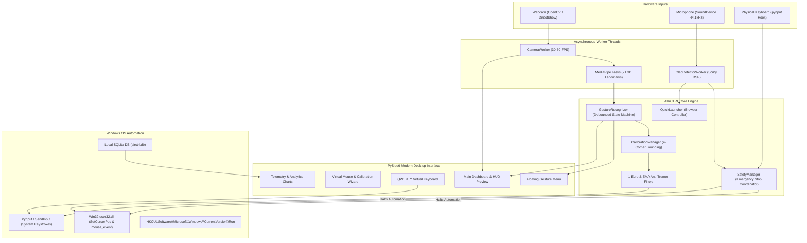

### Computer Vision & Tracking Pipeline
1. **Capture**: OpenCV accesses the hardware camera via DirectShow (`cv2.CAP_DSHOW`) at 640x480 or 1280x720, with automatic fallback to an animated synthetic test feed if no physical webcam is plugged in.
2. **Inference**: MediaPipe Tasks `HandLandmarker` processes RGB frames to predict 21 3D hand coordinates ($x, y, z$).
3. **Geometric Analysis**: Finger extension states (Index, Thumb, Middle, Ring, Pinky), inter-finger Euclidean distances, and handedness are evaluated.
4. **State Machine**: Debounced transition rules map poses into discrete gestures (`CURSOR_MOVE`, `LEFT_CLICK`, `DRAG`, `RIGHT_CLICK`, `DOUBLE_CLICK`, `OPEN_PALM_MENU`, `CLOSED_FIST`).
5. **Tremor Suppression**: Cursor positions pass through a **1-Euro Filter** (adaptive cutoff frequency based on velocity) combined with an **Exponential Moving Average (EMA)** filter to eliminate human hand jitter while maintaining zero latency.

### Acoustic DSP Clap Recognition Pipeline
1. **Audio Streaming**: 44,100 Hz continuous 1-channel audio captured via SoundDevice in 2048-sample blocks (~46 ms chunks).
2. **Butterworth Bandpass Filter**: 3rd-order SciPy bandpass filter isolating 1,500 Hz to 4,500 Hz acoustic energy, discarding low-frequency speech and background fan hum.
3. **Crest Factor Verification**: Computes transient impulse ratio:
   $$\text{Crest Factor} = \frac{\text{Peak Amplitude}}{\text{RMS Energy} + \epsilon}$$
   Only transients exceeding $3.2\times$ crest factor and the ambient noise floor trigger a valid clap pulse.
4. **Sequence Timing Window**: Multi-clap counter tallies pulses within a 1.0s window with a 0.18s refractory pause to prevent room echo re-triggering.

### Hardware Cursor & Keystroke Automation
- **Cursor Positioning**: Direct call to `ctypes.windll.user32.SetCursorPos(x, y)` for instantaneous hardware cursor movement.
- **Mouse Clicking**: Injects native `MOUSEEVENTF_LEFTDOWN`, `MOUSEEVENTF_LEFTUP`, `MOUSEEVENTF_RIGHTDOWN`, and `MOUSEEVENTF_RIGHTUP` events.
- **Keystroke Synthesis**: Sends keystrokes to active Windows applications with modifier tracking (Shift, Caps Lock, Ctrl, Alt).
- **Startup Registration**: Native integration with `HKEY_CURRENT_USER\Software\Microsoft\Windows\CurrentVersion\Run` and the Windows Startup folder.

---

## 2. User Interface Gallery

AIRCTRL features a futuristic dark-theme interface with neon cyan (`#00f2fe`) and electric blue (`#4facfe`) accents, rounded glass cards, and smooth navigation.

### Main Dashboard
Live webcam feed with real-time MediaPipe skeletal overlay, active gesture HUD, system connectivity badges, and KPI telemetry cards.

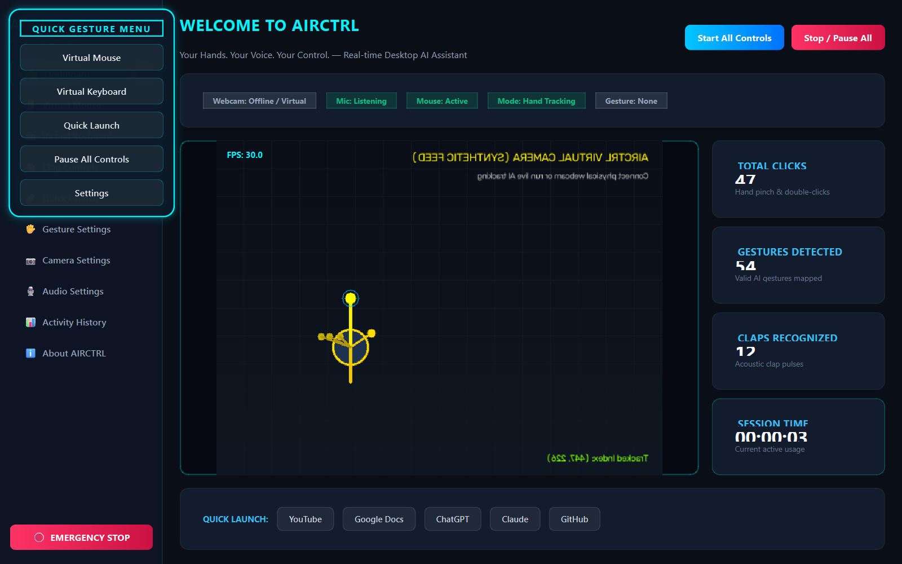

---

### Virtual Mouse & Calibration
Configurable cursor sensitivity, anti-tremor smoothing slider, acceleration curve, and the interactive **4-Corner Screen Calibration Wizard**.

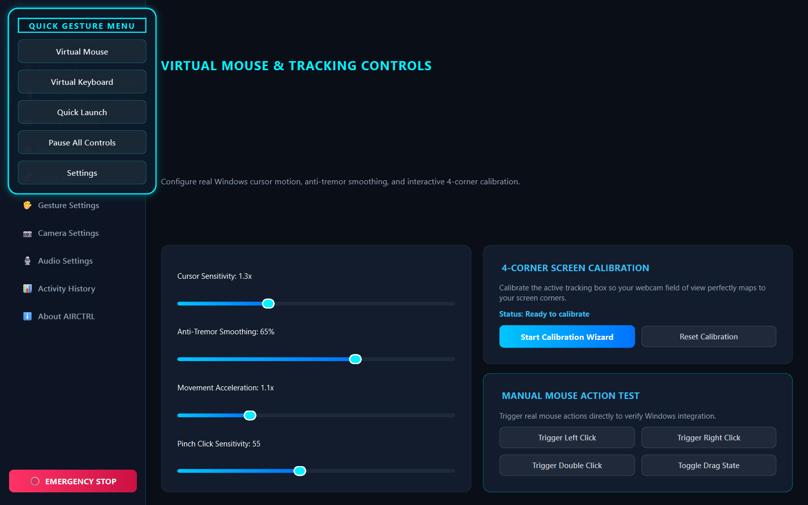

---

### Virtual Keyboard
Full QWERTY desktop keyboard with numbers, symbols, navigation keys, typing preview buffer, direct Windows application typing toggle, and clipboard copy.

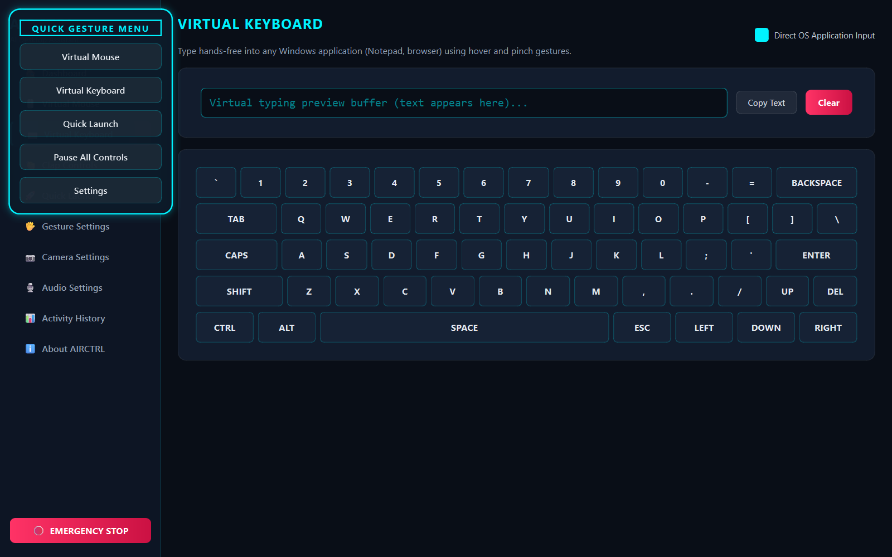

---

### Clap Controls & Audio DSP
Live glowing audio level monitor, background noise calibration button, transient sensitivity slider, and customizable actions for 1, 2, 3, or 4 claps.

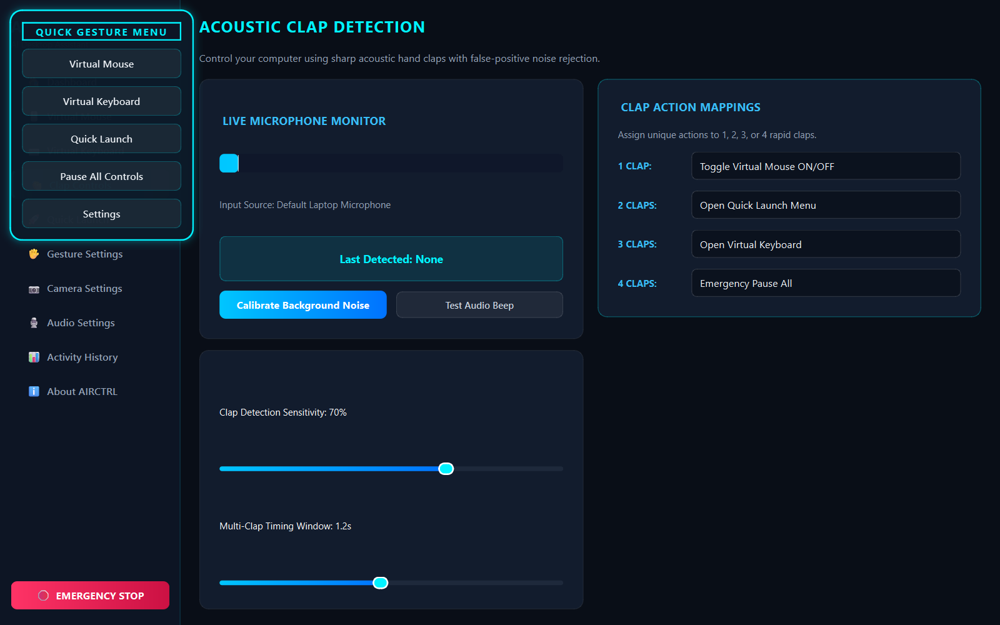

---

### Quick Website Launcher
Instant access to YouTube, Google Docs, ChatGPT, Claude, and GitHub with usage frequency counters, bookmark pinning, and custom site management.

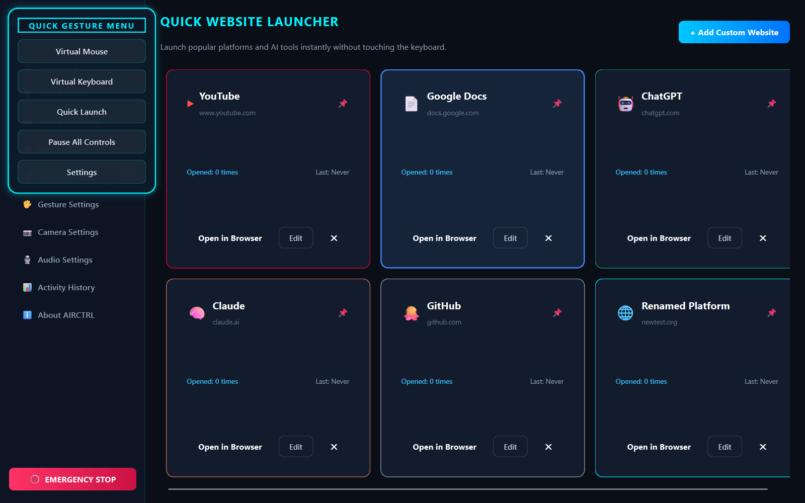

---

### Gesture Settings Matrix
Individual toggle switches for all 7 hand gestures, hold duration configuration, and default restoration.

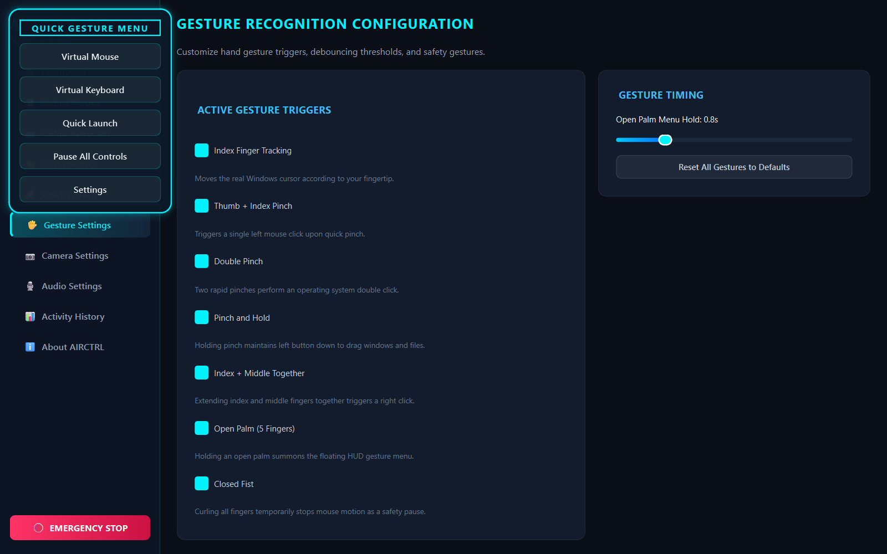

---

### Camera & Windows Autostart Settings
Camera device selector, resolution and framerate choices, MediaPipe confidence thresholds, mirror preview mode, and **Windows Automatic Startup settings**.


---

### Audio Hardware Settings
Microphone device selector, post-clap action cooldown adjustments, and audible action tone toggles.

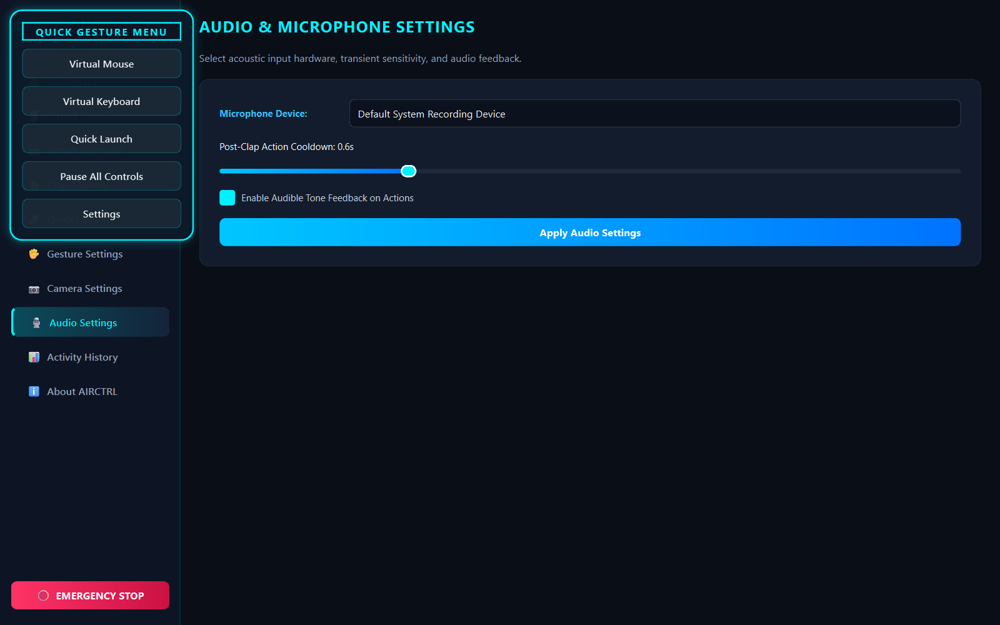

---

### Activity History & Usage Analytics
Interactive daily usage bar chart (last 7 days), lifetime metric counters, and complete interaction audit log stored in local SQLite database.

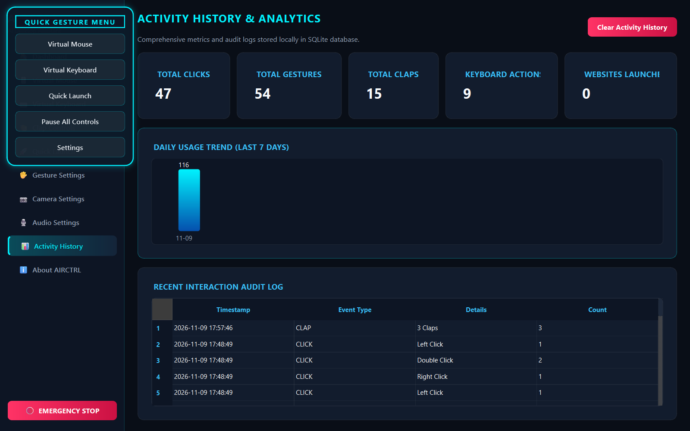

---

### About AIRCTRL & Quick Guide
Comprehensive application details, technology stack documentation, and complete gesture quick-reference manual.

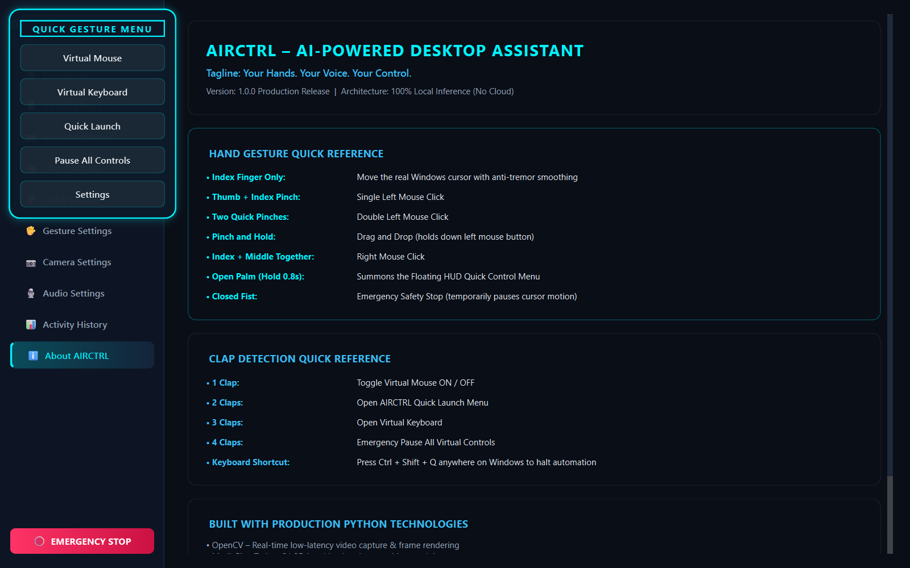

---

### Floating Gesture HUD Menu
Appears dynamically at your pointer when holding an Open Palm gesture for 0.8 seconds, enabling instant navigation without touching the keyboard.

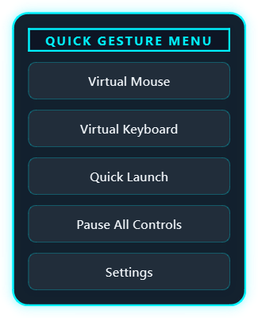

---

## 3. Hand Gesture Reference Manual

| Gesture | Hand Pose | Technical Trigger | Windows Action |
|---------|-----------|-------------------|----------------|
| **Cursor Move** | Index finger pointing up | Index extended, others curled | Smoothly moves the real Windows cursor |
| **Left Click** | Thumb + Index pinch | Thumb-index distance $< 0.055$ | Executes a single left mouse click |
| **Double Click** | Two rapid pinches | Second pinch within 0.40s | Executes an OS double click |
| **Drag & Drop** | Pinch and hold | Pinch held $> 0.35\text{s}$ | Holds left mouse button down for dragging |
| **Right Click** | Index + Middle together | Inter-finger distance $< 0.045$ | Executes a right mouse click |
| **Floating Menu** | Open palm | 4+ fingers extended for $> 0.8\text{s}$ | Summons the on-screen Floating HUD menu |
| **Safety Stop** | Closed fist | 0 fingers extended | Temporarily halts cursor motion |

---

## 4. Acoustic Clap Recognition

AIRCTRL analyzes incoming audio using SciPy digital filters to separate sharp clap transients from human speech:

| Clap Sequence | Default Action | Customization Options |
|---------------|----------------|-----------------------|
| **1 Clap** | **Toggle Virtual Mouse** | Quick Launch, Virtual Keyboard, Emergency Pause, None |
| **2 Claps** | **Open Quick Launch** | Toggle Mouse, Virtual Keyboard, Emergency Pause, None |
| **3 Claps** | **Open Virtual Keyboard**| Toggle Mouse, Quick Launch, Emergency Pause, None |
| **4 Claps** | **Emergency Pause All** | Instant automation halt |

---

## 5. Windows Startup & Autostart Integration

AIRCTRL can start automatically when you log into Windows:

1. Open **Camera Settings** (Camera & System Preferences) from the sidebar.
2. Under **"WINDOWS STARTUP & SYSTEM BEHAVIOR"**, check:
   - **`[x] Launch AIRCTRL automatically when Windows starts`**
   - **`[ ] Start Minimized (Background Assistant Mode)`**
3. AIRCTRL natively registers with:
   ```
   HKEY_CURRENT_USER\Software\Microsoft\Windows\CurrentVersion\Run
   Key: AIRCTRL
   Value: "C:\path\to\AIRCTRL.exe"
   ```
   *(Falls back cleanly to `%APPDATA%\Microsoft\Windows\Start Menu\Programs\Startup` if Registry write permissions are restricted).*

---

## 6. Safety & Fail-Safe Architecture

1. **Global Keyboard Emergency Stop**: Press **`Ctrl + Shift + Q`** from any application to instantly halt automation.
2. **Physical Priority**: The physical mouse and keyboard always retain overriding priority over virtual automation.
3. **Fail-Safe Video Mode**: If the camera is unplugged or disconnected, the app transitions into **Virtual Test Mode** with an animated hand HUD, preventing application crashes.
4. **Clean Exit**: Closing the window cleanly joins and terminates all camera, audio DSP, and hotkey threads.

---

## 7. Installation & Quick Start

### Prerequisites
- Windows 10 or Windows 11 (64-bit).
- Python 3.10+ installed and added to your `PATH`.
- A built-in or USB webcam and microphone.

### Quick 1-Click Setup
1. Clone the repository:
   ```cmd
   git clone https://github.com/ABIZER-web/AIRCTRL.git
   cd AIRCTRL
   ```
2. Run the automated installer:
   ```cmd
   setup.bat
   ```
3. Launch AIRCTRL:
   ```cmd
   run_airctrl.bat
   ```
   *(or run `python main.py`)*

---

## 8. Automated Test Suite

AIRCTRL includes 34 comprehensive unit and integration tests covering the entire system:

```cmd
python -u -m unittest discover tests/
```

```
Ran 34 tests in 0.441s

OK
```

| Test Module | Coverage Scope | Result |
|-------------|----------------|--------|
| `tests/test_gestures.py` | 7 Hand gestures, debouncing, state machine | **PASS (6/6)** |
| `tests/test_mouse.py` | Win32 cursor positioning, mapping, filters | **PASS (5/5)** |
| `tests/test_clap.py` | Butterworth bandpass filter, crest factor | **PASS (4/4)** |
| `tests/test_launcher.py` | Default sites, CRUD, pinning, persistence | **PASS (3/3)** |
| `tests/test_autostart.py` | Windows Run Registry & Startup folder | **PASS (3/3)** |
| `tests/test_integration.py` | Complete end-to-end 13 required scenarios | **PASS (13/13)** |

See [TESTING.md](TESTING.md) for full test metrics and scenarios.

---

## 9. Standalone Executable Packaging

To build a standalone Windows `.exe` that runs without requiring Python to be installed:

```cmd
build_exe.bat
```

The output standalone distribution will be generated in:
```
dist\AIRCTRL\AIRCTRL.exe
```

---

## 10. Project File Structure

```
AIRCTRL/
│
├── main.py                     # Application entry point
├── requirements.txt            # Python dependencies
├── config.json                 # Persistent configuration & user preferences
├── airctrl.db                  # Local SQLite database for activity & audit logs
├── airctrl.spec                # PyInstaller build configuration
├── setup.bat                   # 1-Click Windows dependency installer
├── run_airctrl.bat             # 1-Click application launcher
├── build_exe.bat               # 1-Click PyInstaller executable builder
├── capture_screenshots.py      # Automated high-res screenshot capture tool
├── README.md                   # Comprehensive user guide & documentation
├── TESTING.md                  # Test verification matrix
├── LICENSE                     # Official MIT License
├── .gitignore                  # Git ignore rules
│
├── assets/
│   ├── icons/                  # Vector & graphical assets
│   ├── images/                 # Image assets
│   ├── sounds/                 # System audio feedback
│   ├── screenshots/            # High-resolution application screenshots
│   └── models/
│       └── hand_landmarker.task # Local 21-landmark MediaPipe AI model (7.8 MB)
│
├── app/
│   ├── application.py          # Qt application lifecycle, DPI awareness & theme
│   ├── main_window.py          # Central QMainWindow coordinator
│   ├── navigation.py           # 10-Item Sidebar navigation & emergency stop
│   └── theme.py                # Futuristic dark & light QSS design system
│
├── core/
│   ├── camera_manager.py       # Asynchronous QThread camera with auto-recovery
│   ├── hand_tracking.py        # MediaPipe 21-landmark detector & neon HUD renderer
│   ├── gesture_recognition.py  # State machine for 7 hand gestures & debouncing
│   ├── mouse_controller.py     # Win32 OS hardware mouse cursor & click automation
│   ├── keyboard_controller.py  # Real Windows keystroke injection & debouncer
│   ├── clap_detection.py       # SciPy Butterworth DSP clap recognition
│   ├── quick_launcher.py       # Browser bookmark manager & URL opener
│   ├── calibration.py          # Interactive 4-corner screen calibration wizard
│   └── safety_manager.py       # Global hotkey listener & emergency halt
│
├── ui/
│   ├── dashboard.py            # Main dashboard with live preview, HUD & telemetry
│   ├── virtual_mouse.py        # Sensitivity, smoothness, acceleration & calibration
│   ├── virtual_keyboard.py     # Full QWERTY on-screen keyboard & typing preview
│   ├── clap_settings.py        # Live audio meter & clap action mapping
│   ├── quick_launch.py         # Bookmarks (YouTube, Google Docs, AI tools)
│   ├── gesture_settings.py     # Gesture enable/disable matrix & hold timings
│   ├── camera_settings.py      # Webcam hardware device & resolution selector
│   ├── audio_settings.py       # Microphone device & sound feedback settings
│   ├── analytics.py            # Daily usage trend charts & audit log table
│   ├── about.py                # System architecture & full gesture manual
│   └── components/
│       ├── webcam_widget.py    # Hardware-accelerated video preview widget
│       ├── floating_menu.py    # Floating gesture HUD overlay menu
│       ├── audio_meter.py      # Glowing LED audio level bar
│       └── stat_card.py        # Modern metric card
│
├── database/
│   ├── database.py             # Thread-safe SQLite connection & schema
│   └── history_manager.py      # Audit log & daily analytics aggregator
│
├── utils/
│   ├── autostart.py            # Windows Startup Registry & autostart manager
│   ├── settings_manager.py     # Thread-safe JSON settings manager
│   ├── logger.py               # Rotating file & console logging
│   └── helpers.py              # 1-Euro & EMA filters, coordinate math & sound
│
└── tests/
    ├── test_gestures.py        # 7 Gestures unit tests
    ├── test_mouse.py           # Mouse positioning & filters tests
    ├── test_clap.py            # Audio DSP & clap tests
    ├── test_launcher.py        # Quick launch CRUD tests
    ├── test_autostart.py       # Windows autostart unit tests
    └── test_integration.py     # 13 Required scenario integration tests
```

---

## 11. License & Copyright

This project is licensed under the **MIT License**.

```
MIT License

Copyright (c) 2026 Abizer Saifee

Permission is hereby granted, free of charge, to any person obtaining a copy
of this software and associated documentation files (the "Software"), to deal
in the Software without restriction, including without limitation the rights
to use, copy, modify, merge, publish, distribute, sublicense, and/or sell
copies of the Software, and to permit persons to whom the Software is
furnished to do so, subject to the following conditions:

The above copyright notice and this permission notice shall be included in all
copies or substantial portions of the Software.

THE SOFTWARE IS PROVIDED "AS IS", WITHOUT WARRANTY OF ANY KIND, EXPRESS OR
IMPLIED, INCLUDING BUT NOT LIMITED TO THE WARRANTIES OF MERCHANTABILITY,
FITNESS FOR A PARTICULAR PURPOSE AND NONINFRINGEMENT. IN NO EVENT SHALL THE
AUTHORS OR COPYRIGHT HOLDERS BE LIABLE FOR ANY CLAIM, DAMAGES OR OTHER
LIABILITY, WHETHER IN AN ACTION OF CONTRACT, TORT OR OTHERWISE, ARISING FROM,
OUT OF OR IN CONNECTION WITH THE SOFTWARE OR THE USE OR OTHER DEALINGS IN THE
SOFTWARE.
```
